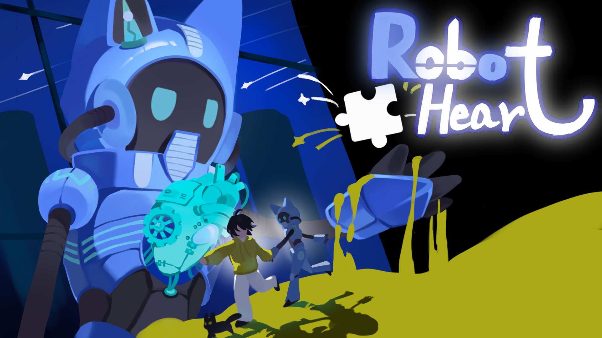
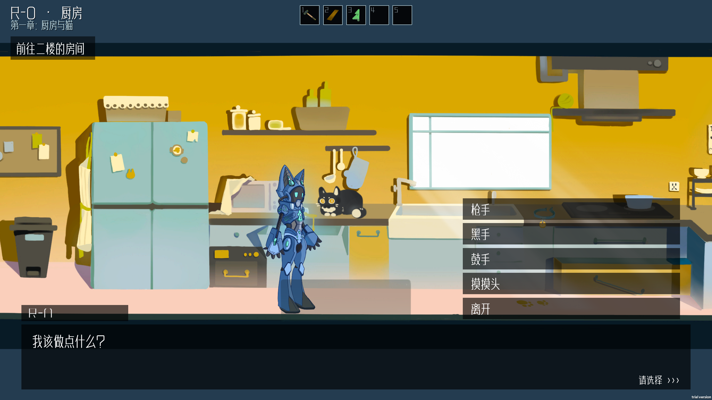
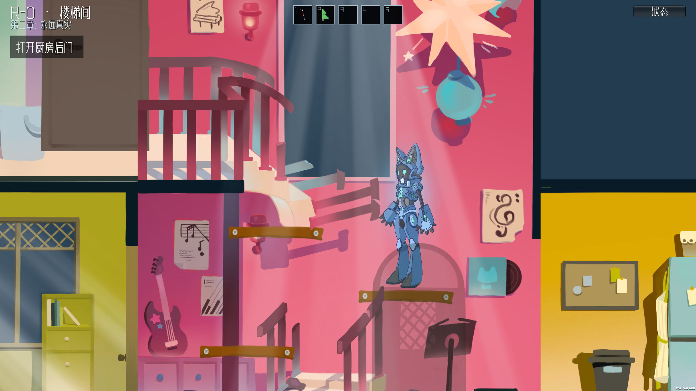
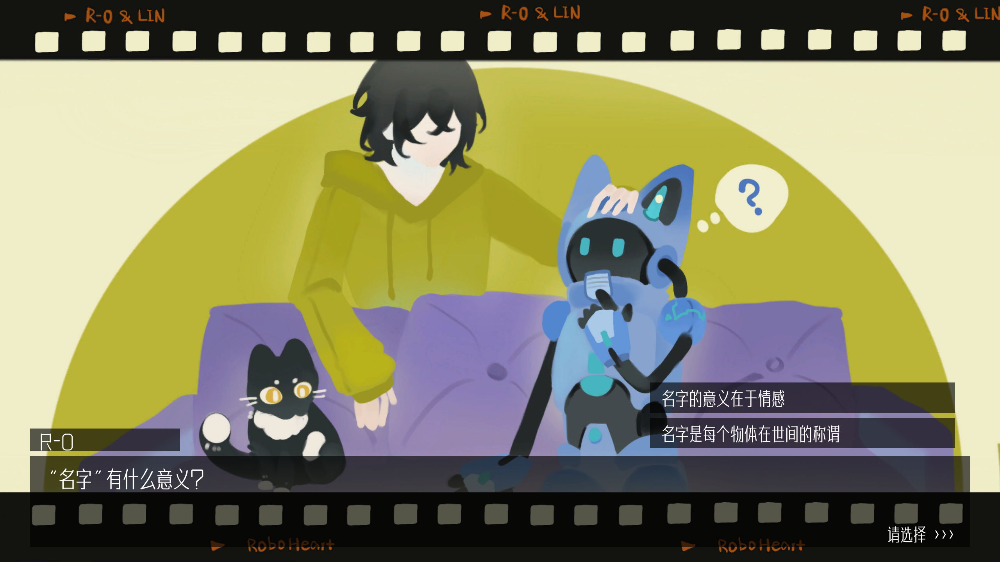
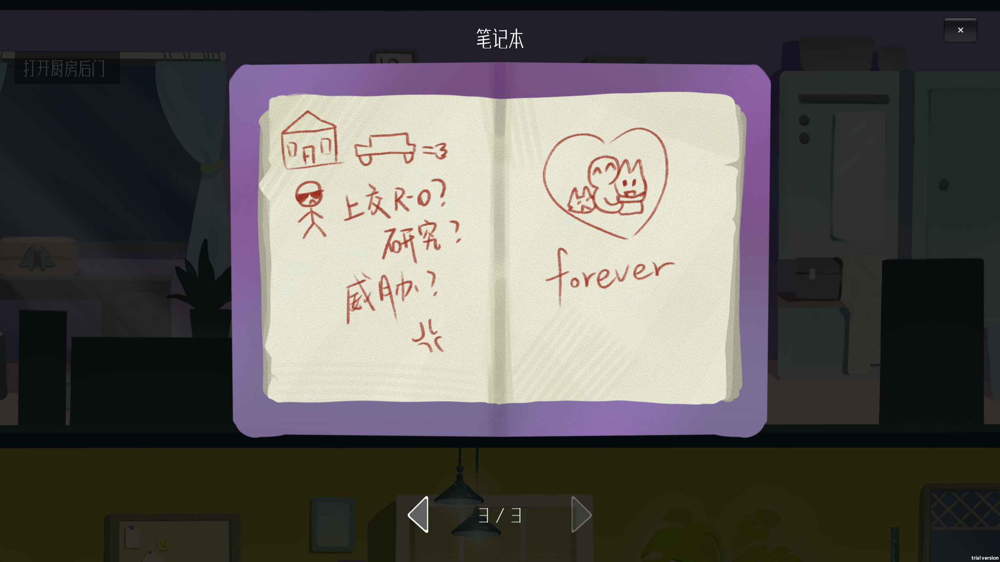

# Roboheart · 涌现

**TapTap 聚光灯 21 天 Game Jam 游戏创作挑战 · 2D 叙事解谜 · 主程序作品展示**

[下载 Windows v1.2.1](https://github.com/zzh096/roboheart-showcase/releases/download/v1.2.1/Roboheart-v1.2.1.zip) · [查看演示视频](media/gameplay.mp4) · [程序设计](docs/TECHNICAL_OVERVIEW.md) · [团队署名](CREDITS.md)

## 关于游戏

《Roboheart》是一款 2D 叙事解谜游戏。残次品机器人 R-0 在主人林意外离世后重新启动，为完成最后的指令踏上寻找灵魂碎片的旅程。玩家将在旧日生活的场景中探索、解谜、收集记忆，看着一个原本不懂情感的机器人，在回忆中逐渐“涌现”出属于自己的心。

项目包含序章与三个章节。TapTap 页面厂商署名为**空白格**；我以 **啊Siri / zzh096** 署名，在团队中担任**主程序**。

## 试玩与演示

| 内容 | 入口与说明 |
| --- | --- |
| Windows x64 · v1.2.1 | [下载游戏包](https://github.com/zzh096/roboheart-showcase/releases/download/v1.2.1/Roboheart-v1.2.1.zip)，约 102 MiB，解压后约 2.31 GiB |
| 演示视频 | [查看 / 下载 MP4](media/gameplay.mp4)，约 54 秒，1280 × 720 |
| 浏览器版 | 待构建与上线，暂未提供在线试玩 |

请在 Windows 上**完整解压** ZIP，进入 `Roboheart-v1.2.1` 文件夹后运行 `Roboheart.exe`，保留旁边的数据文件与运行库。下载包的校验值、版本范围和说明见 [v1.2.1 Release](https://github.com/zzh096/roboheart-showcase/releases/tag/v1.2.1)。

## 实机画面

| 厨房与猫 | 楼梯间探索 |
| --- | --- |
|  |  |

更多画面：回忆与线索（含少量剧情及谜题内容）

## 主程序工作与技术实现

技术栈：**Unity 6000.6.0f1 / C# / Unity 2D / IMGUI**。

- **统一交互与道具使用**：集中处理目标选择、查看、拾取和机关操作。
- **自动存档与恢复**：共同保存库存、收集记录、机关和剧情阶段，支持中途继续游戏。
- **解谜小游戏**：动物配对、透卡对齐、拖拽旋转修补，并将有效进度接入章节状态。
- **剧情与 CG 演出**：配置驱动的文本和选项、人物图层淡出、阅读节奏、暂停与长按跳过。

进一步阅读：[项目概况](docs/PROJECT_OVERVIEW.md) · [程序设计说明](docs/TECHNICAL_OVERVIEW.md)

这是团队项目，具体署名见 [团队表](CREDITS.md)。以上展示程序侧工作，不代表美术、剧本、音频或全部代码由个人独立完成。

## 操作与存档

展开操作说明

| 输入 | 行为 |
| --- | --- |
| A / D 或左右方向键 | 移动 |
| 空格 | 跳跃；普通对白补全 / 继续 |
| E | 交互；普通对白继续 |
| 鼠标左键 | 拾取、查看、操作机关、选择物品栏 |
| F | 使用选中的道具 |
| Q | 查看物体 |
| 1–5 / 滚轮 | 切换道具 |
| 拖动；相关小游戏中滚轮 / 右键 | 移动、旋转道具 |
| Esc | 暂停并查看完整操作提示 |
| CG 中长按 Q 约 2 秒 | 跳过当前整段 CG |

游戏自动保存有效进度；“继续游戏”恢复最近存档，“开始游戏”重新开始并覆盖自动存档槽。CG 对白自动播放，完整显示后保留阅读时间。

试玩问题可通过 [Issues](https://github.com/zzh096/roboheart-showcase/issues) 反馈，请写明版本、平台、章节和复现步骤。

## 内容与后续计划

本库用于展示与成品分发，现已加入经确认的宣传资料、实机图、视频和 Windows 包；游戏源代码与独立音频、字体等素材原文件未在此公开。尚未声明统一开源许可证，公开展示不等于授予全部内容自由复用的权限。

后续待补：比赛 / 游戏的实际页面链接、网页试玩版、可公开的源码范围，以及必要的第三方素材声明。详见 [后续清单](docs/PUBLISH_CHECKLIST.md)。
